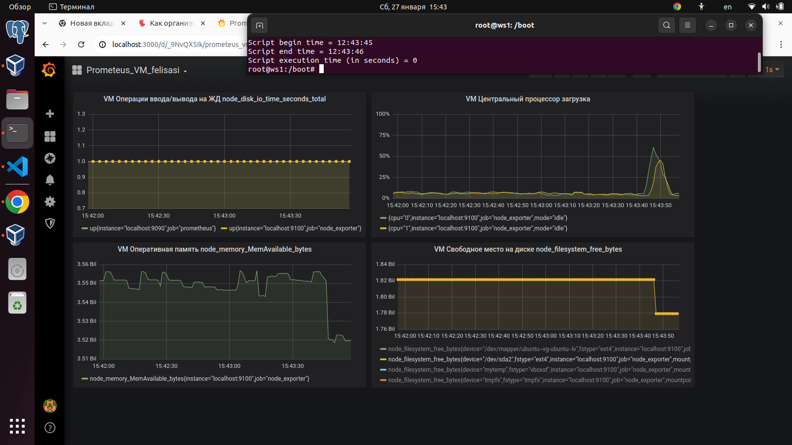
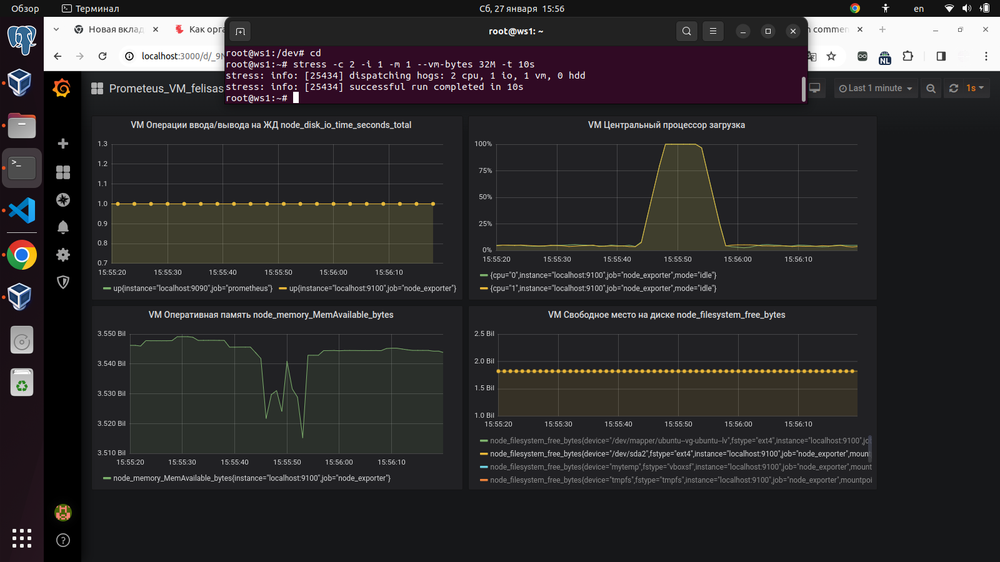

## 1. Установка Prometheus, Node_exporter и Grafana
**1.1** Cмотрим скрипт [main.sh](/src/07/main.sh) там дополнительные указания
Prometheus и Node_exporter устанавливаются на виртуальную машину, а Grafana на Хост-машину:

```bash
sudo snap install grafana
``` 
**1.2** В браузере Хост машине в адресную строку вводим http://localhost:3000/ По умолчанию логин **admin** и пароль **admin**. \
**1.3** Указываем источник данных: \
http://localhost:3000/datasources/new?gettingstarted \
HTTP -> URL: `http://localhost:9096` \
**1.4** Создаем Дашборд: \
http://localhost:3000/dashboard/new?editview=dashboard_json&orgId=1 \
Скрипт формирующий доску в файле: [Dashboard.json](/src/07/Dashboard.json) \
**1.5** Проброс туннеля между портом 9096 (можно любой другой порт выбрать) хост машины и порта 9090 локальной машины (где слушает и отвечает Прометей)
```bash
ssh -L 9096:localhost:9090 -p 12345 felisasi@127.0.0.1
```

## 2. Grafana после применения [02/main.sh](/src/02/main.sh)

Рисунок 7.1. Видим после запуска скрипта проседают графики свободной оперативной памяти и свободного места на диске. При этом подскакивает ЦПУ (купол).

## 3.  Grafana после stress-теста

Устанавливаем на хост машине пакет
```bash
sudo apt install stress
```
И запускаем службу
```bash
stress -c 2 -i 1 -m 1 --vm-bytes 32M -t 10s
```


Рисунок 7.2. Видим после запуска стресс-теста проседают графики свободной оперативной памяти и подскакивает ЦПУ (купол).