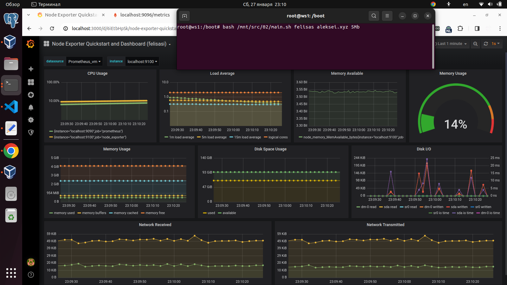
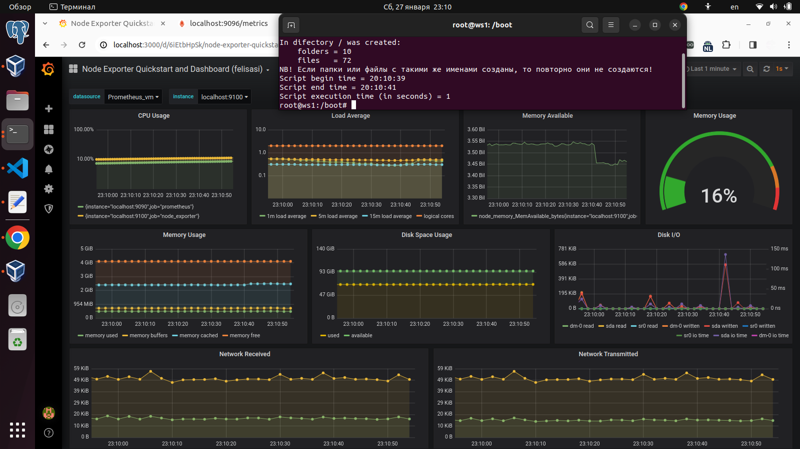
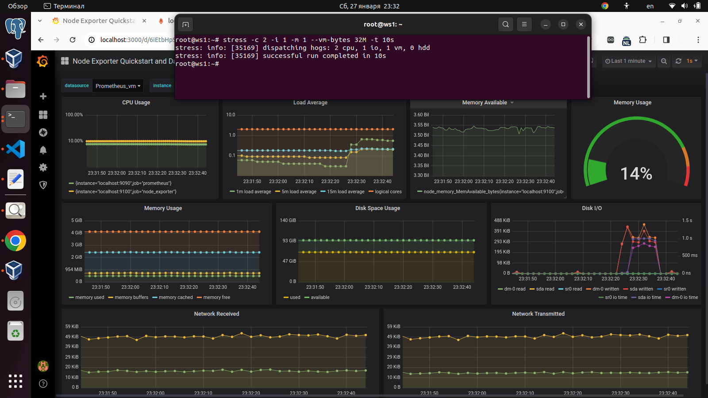
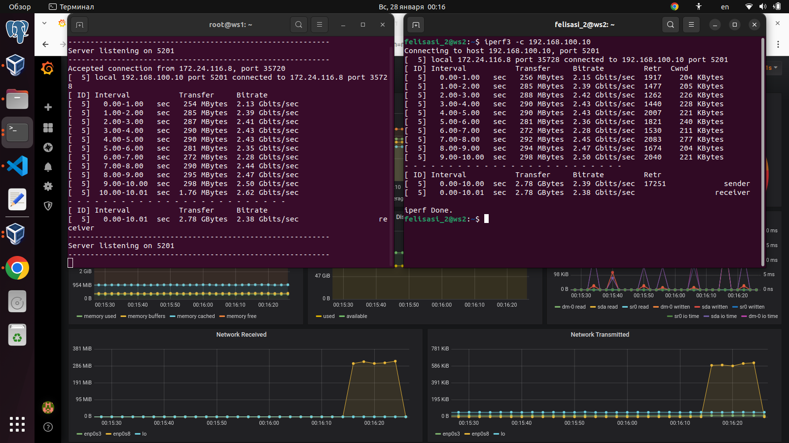

## 0. Предварительные ~~лас..~~ настройки
[Находим](https://grafana.com/grafana/dashboards/?search=Node+Exporter+Quickstart+and+Dashboard) и [cкачиваем последнюю версию](https://grafana.com/grafana/dashboards/13978-node-exporter-quickstart-and-dashboard/) Node Exporter Quickstart and Dashboard 

[Скаченный скрипт](Node%20Exporter%20Quickstart%20and%20Dashboard.json) помещаем в настройки [новой панели](http://localhost:3000/d/6iEtbHpSk/node-exporter-quickstart-and-dashboard?editview=dashboard_json).
где "Prometheus_vm" - моё название источника.


## 1. Grafana до и после запуска скрипта [02/main.sh](../02/main.sh)


Рисунок 8.1. а) до и б) после применения скрипта [02/main.sh](../02/main.sh). Видим на singlestat увеличение занятого пространства с 14% до 16%, скачек параметра Disk I/O (метрика `node_disk_read_bytes_total`) и провал метрики `node_memory_MemAvailable_bytes`

## 2. Grafana после stress-теста

```bash
stress -c 2 -i 1 -m 1 --vm-bytes 32M -t 10s
```

Рисунок 8.2. Скачек параметра Disk I/O (метрика `node_disk_read_bytes_total`) продолжительностью около 10 секунд.


## 3. Grafana после нагрузки сети с помощью утилиты iperf3
**3.1.** Запустить ещё одну виртуальную машину, находящуюся в одной сети с текущей. В настройках сети каждой виртуальной машины включаем второй адептер "Внутренняя сеть".
На каждой из машин должен быть установлен пакет 
```bash
sudo apt install iperf3
```
**3.2.** На первой машине узнаем её сетевой адрес `ip a` (в моём случае это 192.168.100.10) а затем запускаем на ней прослушку порта командой: 
```bash
iperf3 -s
```
Теперь машина 1 будет работать как сервер и будет ожидать получения данных.

**3.3.** На второй машине запускаем тест нагрузки сети с помощью утилиты iperf3:
```bash
iperf3 -c 192.168.100.10
```

И смотрим на нагрузку сетевого интерфейса:

Рисунок 8.3. Видим прямоугольный сигнал по времени, длительбностью около 10 секунд, показывающий наличие нагрузки.